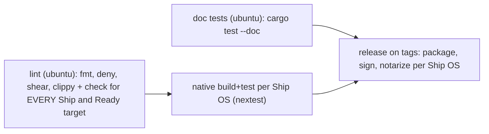

# Tooling, Lints, Supply Chain, and CI

## Tool install (fast, prebuilt binaries)

```bash
cargo install cargo-binstall
cargo binstall -y cargo-nextest cargo-deny cargo-shear cargo-llvm-lines cargo-hakari \
  cargo-sweep cargo-llvm-cov cargo-semver-checks cargo-xwin sccache
```

| Tool | Purpose |
| :-- | :-- |
| `cargo-nextest` | Parallel process-per-test runner, partitioning, archives, retries |
| `cargo-deny` | Licenses, RustSec advisories, banned/duplicate crates, allowed sources |
| `cargo-shear` (or `cargo-machete`) | Finds unused dependencies, a common source of build bloat |
| `cargo-hakari` | Workspace-hack crate for stable feature unification |
| `cargo-llvm-lines`, `cargo-bloat` | Monomorphization / binary size analysis |
| `cargo-llvm-cov` | Coverage (works with nextest) |
| `cargo-semver-checks` | API breakage checks for published libraries |
| `cargo-sweep` | Prunes stale artifacts in `target/` (disk hygiene) |
| `cargo-xwin` | Windows MSVC builds from macOS/Linux |
| `sccache` | Compilation cache for CI / ephemeral VMs |
| `miri` (nightly component) | Undefined-behavior checks for crates with `unsafe` |

## Workspace lints (single source of truth)

Define lints in the root `Cargo.toml` under `[workspace.lints]`. Each member opts in with
`[lints] workspace = true` (see `resources/templates/Cargo.toml`). Highlights:

- rust: `unsafe_op_in_unsafe_fn = "deny"`, `unreachable_pub = "warn"`.
- clippy: `all = warn`, `await_holding_lock = "deny"`, `large_futures = "warn"`,
  `dbg_macro = "warn"`, `todo = "warn"`, `unwrap_used = "warn"` (allowed in tests
  via `clippy.toml` `allow-unwrap-in-tests = true`).
- Use `#[expect(...)]` for local exceptions so stale ones get flagged.
- Deny warnings **in CI only** (`cargo clippy -- -D warnings`). Locally, warnings stay
  warnings so iteration isn't blocked.

## Local gates (fast)

```bash
cargo fmt --all --check
cargo clippy --workspace --all-targets
cargo nextest run --workspace
```

## CI pipeline shape (generated from PLATFORMS.md tiers)



Rules:
- Use the `ci` Cargo profile (no incremental, no debuginfo), `Swatinem/rust-cache`,
  and `taiki-e/install-action` for tools.
- Use `--locked` everywhere in CI. The lockfile is committed.
- Cross-target `check`/`clippy` runs on the cheap Linux runner, before any slow OS
  runner starts.
- Partition big test suites: `cargo nextest run --partition count:${{ matrix.part }}/N`.
- Track build time: upload `target/cargo-timings/*.html` as an artifact on main.
  Investigate if clean build time grows more than 20%.

Template: `resources/templates/ci.yml`, written by `scaffold_workspace.sh` with the
right matrix.

## Dependency policy (prevents slow builds over time)

- New dependency? Check duplicates (`cargo tree -d`), the transitive count, proc-macros
  and build scripts, and `default-features`. Prefer cross-platform crates (see
  platforms.md §3).
- `cargo deny check` with `[bans] multiple-versions = "warn"`.
- Run `cargo shear` monthly. Batch `cargo update` weekly in its own PR.

## Disk hygiene (big Rust projects eat disk)

- Every distinct profile, target triple, toolchain, and flag set gets its own
  artifact tree. A large workspace can use 5–20 GB **per tree**.
- **Before experiments or benchmarks** that create extra target dirs: check free space
  (`df -h .`, or `Get-PSDrive` on Windows), plan ≤ 50% of free space, and delete each
  experiment's target dir before starting the next.
- Run `cargo sweep --time 14` (removes artifacts unused for 14 days) or
  `cargo clean --profile <old>` routinely.
